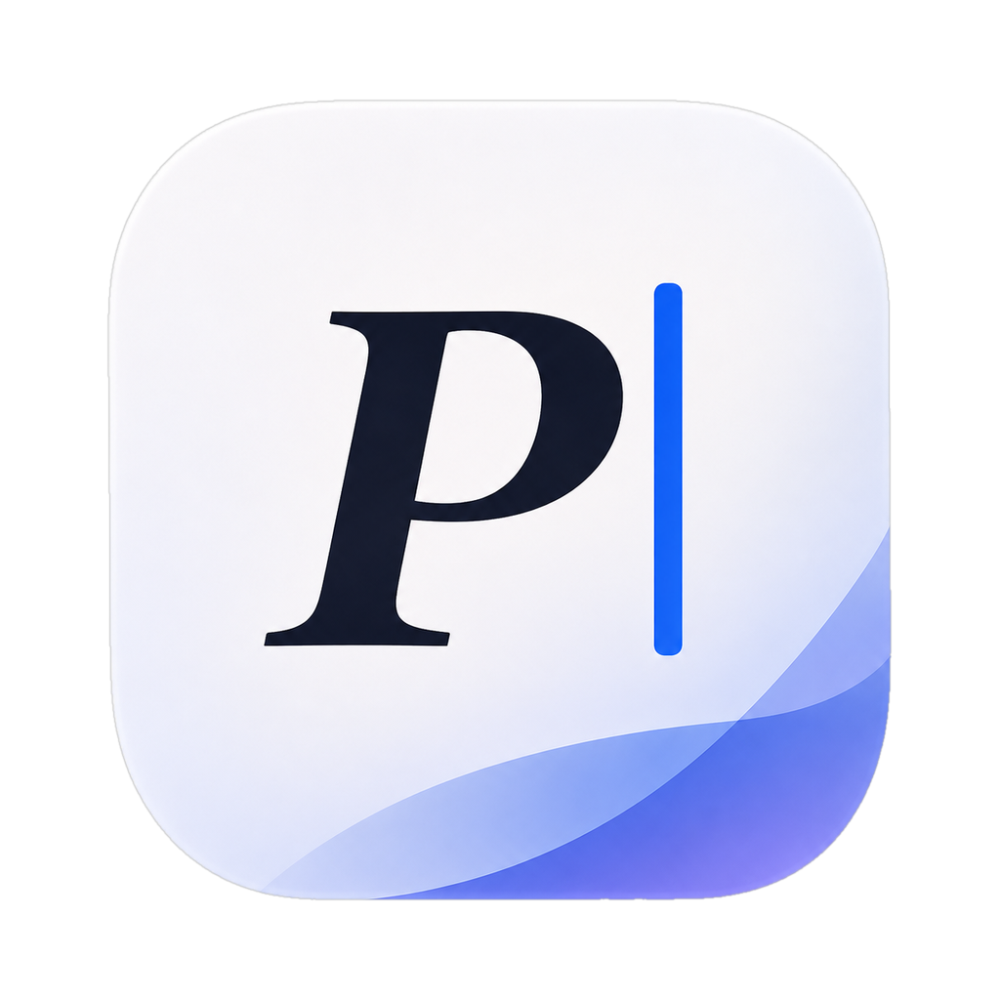

<p align="center"></p>

# Prose

Prose is a native macOS editor for writing long documents in Typst: a thesis, an article, a book. It will show one source file three ways. Code mode shows the source. Writing mode shows the same text as typeset blocks. Focus mode hides everything but the paragraph you are writing.

The `.typ` file on disk is always the source of truth. Nothing in the rendered views can produce text that is not in the source.

Prose is in early development and has no release yet. Today it is the LeftBlank editor under a new name, icon and palette. The design and the plan for the work ahead are in [the Prose spec](docs/prose-spec.md).

## Build

Prose needs macOS 14 or later on Apple silicon, Xcode 26 or later, and Rust 1.92.0 through rustup (`rustup toolchain install 1.92.0 --profile minimal`). Build and test from the repository root:

```sh
scripts/build.sh release
scripts/test.sh
```

The first build compiles Tinymist from source and takes about 15 minutes. Later builds reuse it. The build writes `build/Prose.app` with a development signature. See [development](docs/development.md) for the details.

## Based on LeftBlank

Prose is based on [LeftBlank](https://github.com/leftblank-app/leftblank) by Wang Fenjin, an independent project that Prose is not affiliated with. LeftBlank's code is used under the [MIT License](LICENSE). Its names, logo and icons are not used, as its [brand policy](BRAND_POLICY.md) requires. Most documents in `docs/` were written for LeftBlank and describe the inherited code.

Third-party components and their licences are listed in [Resources/ThirdParty.txt](Resources/ThirdParty.txt).
