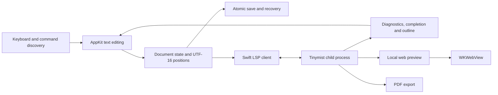
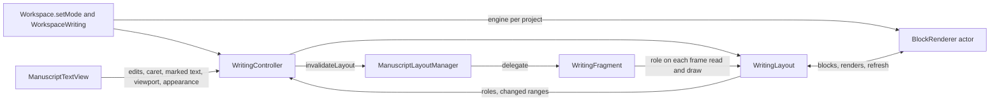

# Prose architecture

The architecture prioritizes native input, maintainability, offline writing and reuse of Tinymist. Integrations follow the observed behavior of pinned versions rather than assumptions about undocumented protocols.

## Platform and packaging

- Swift 6.2 or later (Xcode 26 or later) and macOS 14 or later, with arm64 builds.
- Swift Package Manager separates core logic, the importable app library and a thin launcher so tests exercise production app code.
- AppKit owns windows, menus, dialogs and text editing; SwiftUI composes layouts, lists and command interfaces.
- Tinymist **0.15.8** is built from its pinned upstream commit with Prose's checked-in patches (macOS native TLS and a VFS revision fix) and bundled with every Mac edition. It contains Typst 0.15.1.
- typst-syntax 0.15.1 (the same Typst fork) is linked into the app as a static library behind a small C ABI ([parser bridge](visual-editing.md#parser-typst-syntax-through-a-c-abi)), carried by the engine library (`Engine/RenderBridge`).
- Prose is Mac only. The inherited iPad target was removed on 2026-11-08.
- The running app needs no Rust toolchain, Homebrew or separate Typst installation. Uncached external packages may require a network download; cached packages work offline.
- A small local set of Phosphor icons is bundled with its license.

## Data flow

## Document state and storage

There is one active editing buffer. Navigating from the main document into an included file preserves the main compilation entry; the child buffer is opened before the main file when synchronizing with Tinymist. Explicit opening or saving under a new name establishes a new entry.

Document state includes file URL, main URL, source, monotonic revision, selection, saved baseline and diagnostics. Untitled documents use an app-managed draft location. Changing location updates the resource root and LSP document identity.

Asynchronous results are checked against document revision, selection and service session. Compilation state comes from Tinymist notifications. Versioned diagnostics are filtered; some notifications in the pinned server omit a revision, so fast typing can briefly show the previous round's feedback. Diagnostics are not claimed to be perfectly synchronized with each keystroke.

Writes are atomic. Autosave checks the on-disk baseline first and stops when another application changed the file. Local work remains recoverable, with reload and save-as available. Shutdown flushes recovery data; unsaved text must not exist only in a view.

## Native editing

`NSTextView` and `NSScrollView` send small editing events to the workspace. Ordinary typing does not rebuild the view, replace the whole buffer or steal first responder.

Positions use Foundation `NSString` / `NSRange` UTF-16 units, consistent with the negotiated LSP encoding. Tests cover Chinese, emoji, combining characters, CRLF and end-of-document positions.

Full-buffer replacement is reserved for opening, external reload and deliberate formatting. Highlighting changes attributes without creating undo operations. Marked text delays styling and completion application. Insertion uses `NSTextView.insertText(_:replacementRange:)` and a single undo group. Because AppKit may create its undo manager only after the first edit, observation attaches at edit time and synchronizes workspace state after undo/redo completes.

Both editors are TextKit 2 views styled by one `SourceStyler` from `ProseCore` ([editor styles](visual-editing.md#the-editor-now)). `SourceStyleEngine`, an actor, mirrors the buffer in `SyntaxTree` (typst-syntax, incremental) and returns the heading, strong, emphasis and raw runs of the paragraphs each batch of edits reparsed; the main thread sets them as fonts on the text storage and never waits for it. The laid-out text is the source itself: no hidden characters, attachments or substituted display text (a visual layer that did that was removed on 2026-10-09). Semantic colours are rendering attributes, so a reply never re-lays out text.

Indentation and comments use text-range transformations. Formatting uses the real LSP response with revision, session and range validation.

## Project folders and the window shell

A project is a folder opened in place (`Workspace.openFolder`). `ProjectStore` remembers recent folders in `Application Support/Prose/Projects/recent.json`: path, bookmark (security-scoped when sandboxed), main entry, expanded folders and the project's Zotero link (`ProjectRecord.zotero`, Phase 5 step E). Nothing is written into the folder. `ProjectTree` lists children (folders first, Finder order, no hidden files or links), searches names and creates, renames and trashes items without leaving the root; trash uses `FileManager.trashItem`. When a project is open, `Workspace.open` sets the compilation entry to the project's main entry, so preview and export compile the whole document from any file. A file reopened after relaunch finds its folder in the recent list. `ProjectWatcher` refreshes the sidebar through FSEvents (0.1 s latency) and passes the changed paths to `Workspace.projectFilesChanged`, which feeds the block engine (below). A library document shows its own folder, with the library's `document.json` hidden and its entry fixed.

The sidebar (`ProjectSidebar`) is a column left of the editor, 240 to 320 points wide, stored per device. It lists the tree and nests the open file's headings from `OutlineNavigation`; without a folder it holds only the outline. The floating margin outline is shown only while the sidebar is hidden. The toolbar holds the sidebar button, the file and folder names, a breadcrumb from `OutlineNavigation.ancestry`, a status dot from `CompileStatus`, the Code, Writing and Focus control (`EditorMode`; a document opens in Code mode until per-document mode memory arrives in Phase 6), Export and the preview toggle. Preview pages are styled as cards from the injected stylesheet; the pane header shows the current page from `PreviewReadingSession.currentPage`.

## Render bridge

The Mac app links one Rust static library, `ProseEngine.xcframework`, built from `Engine/RenderBridge` by `scripts/build-render.sh`. It contains Typst 0.15.1 (the same fork and tag as Tinymist) and re-exports the syntax bridge's `lb_syntax_api`, so the app carries one Rust runtime. Its C ABI is the function table `prose_render_api()`; every entry point that does work catches panics.

`BlockRenderer` (ProseCore, an actor) owns one engine per document. `setText` replaces a file's text in memory; `refresh` runs a full compile of the main file with a small probe that records every heading's and equation's counter value, and reads what each reference displays from the links in the output. `blocks` lists every top-level piece of a file in order, so the blocks cover all text other than whitespace between them. Each block has a kind: heading, equation, paragraph, raw (one fenced raw block), list (only list items), context (a `#set`, `#show`, `#let` or `#import` line), include (an `#include` line) or comment (only comments). Context, include and comment blocks are pills in Writing mode and are not rendered. `render` builds a block document (the file's context lines, a transparent page as wide as the measure, counter updates, stub labels with the full document's reference text, then the block; a block that cites or holds the bibliography also gets every key the full document cites, in order, and the document's `bibliography(...)` call, placed and hidden, so Typst formats its citations and entries as in the whole document; this happens only when the `bibliography(...)` call is in the same folder as the block's file, and otherwise citations show `??`), compiles it, and returns SVG, size, first baseline, ink bounds, the drawn area and glyph boxes with UTF-16 source offsets. The drawn area is the page together with any ink outside it, such as punctuation that hangs past the measure; the SVG and bitmap cover it. On request, `render` also returns a premultiplied RGBA bitmap of the drawn area at a given scale (`typst-render`), which `BlockRenderer` wraps in a `CGImage` inside the actor. Results are cached in an LRU with a byte budget (64 MB by default), keyed by the block document, the width and the appearance and checked against the edit version of every file the compile read. A cache entry keeps the laid-out page, so a cached block can be rasterized without compiling; bitmaps themselves are not cached, because a viewport of them at scale 2.6 would fill most of the budget. Typst's own memo caches are evicted after each refresh and every 128 compiled renders. `filesChanged` (C ABI version 3, Phase 5 step A) reports files changed on disk: the engine calls `FileStore::reset()`, so every file it loaded from disk is read again on its next use, and gives each changed file a new version, so cached renders that read it miss. Editor buffers set with `setText` keep their text, and paths outside the root are ignored. It returns how many of the files the main file, the last refresh or any render read; 0 means nothing shown can have changed. On SICP the call takes under 0.1 ms, and reading the files again adds about 30 ms to the next refresh. Render results also carry the block's plain text, for tests. `bibliographyFiles` and `bibliography(_:)` (C ABI version 4, Phase 5 step B) feed the citation index: the first lists the files the project's `bibliography(...)` calls name, from the syntax trees of the main file and its includes; the second parses files with Hayagriva as Typst does, reads them through the engine's file store (editor buffers win; `filesChanged` makes them read again), caches each file's parse by version, and returns entries (key, type, title, authors, year, container, DOI, URL, file, line) and errors (file, line, message) as JSON that the actor decodes. `BibliographyIndex` (ProseCore, main actor) holds the result for the picker: when no call names a file it lists every `.bib`, `.yml` and `.yaml` file in the project tree (`ProjectTree.bibliographyFiles`) and marks them as not linked, builds its search table off the main thread, and moves its `revision` only when the entries change. A search is a `memmem` pass over one folded UTF-8 buffer of all entries, ranked key prefix, author or year prefix, title word prefix, then anywhere. In dark appearance (C ABI version 5, `PRRenderOptions.dark`), the block renders with the document's own colours and the engine then maps every paint of the laid-out page, but not images, in OKLab onto the dark page (`Engine/RenderBridge/src/dark.rs`): black ink becomes `#E8E4DE`, white becomes `#262626`, hue is kept; the SVG and the bitmap are made from the mapped page. The C ABI is version 5. Writing mode (below) is the editor's only client of the render calls.

## Writing mode

Writing mode draws the open file as typeset blocks in the same `ManuscriptTextView`. It works only in the TextKit 2 layout layer: entering, leaving, a swap and a render result change nothing in the text storage, the selection or the undo stack ([why](visual-editing.md#writing-mode-in-prose-the-rule-kept)). Design, decisions and measurements are in `docs/plans/2026-11-08-phase-3-writing-mode.md`; Focus mode, the floating toolbar and spell check are in `docs/plans/2026-11-09-phase-4-focus-toolbar-spellcheck.md`.

| Part | What it does |
|-|-|
| `WritingLayout` (ProseCore) | The main-actor model for one open file, with no AppKit drawing. It holds the engine's block list and rebases it across native edits; after edits settle (150 ms) it sends the text to the engine and takes the engine's list, and it asks for `refresh()` after a 1.5 s pause, and at once after `filesChangedOnDisk()`. A refresh that succeeds, and any refresh after a change on disk, starts a new render epoch, so every block in view asks for its render again; the engine's cache answers for blocks whose block document and files are unchanged, and a render with the same picture keeps the image shown. It resolves the active block from the caret's moving end and the marked text, decides each block's state (source with a reason, rendered, or pill) and schedules renders near the viewport, nearest first. `role(forParagraph:)` answers `source`, `rendered`, `collapsed` or `pill` for one TextKit paragraph; `onChange` names the ranges whose roles changed. While text is marked nothing changes, except that a block the composition edits opens. The renderer is the `WritingRenderer` protocol, which `BlockRenderer` conforms to, and timing is injected (`WritingTiming`), so tests script both. |
| `WritingController` (`WritingMode.swift`) | One per editor (`editor.writing`). It starts and stops the model for the open file, forwards the editor's edits, the selection's moving end, marked text, the visible range and the appearance (column width, 1.3 times scale, bitmap scale, dark flag), and applies role changes: `invalidateLayout(for:)` of the changed ranges, with the top line, or the caret's line when its block opens, kept in place. Entry holds swaps for up to 100 ms until the viewport's renders arrive. It remembers selections the pointer made, which open no block. |
| `WritingFragment` and the layout manager delegate (`WritingFragments.swift`) | The controller is the layout manager's delegate and gives every paragraph a `WritingFragment`. The fragment reads its role on a frame read or draw and keeps it until `WritingLayout.roleRevision` changes (every change of the blocks, every edit, start and stop), because TextKit reads several thousand frames per scrolled frame. An image whose pixel size matches its rectangle on the device draws at exactly that size with its top-left corner on a device pixel and no interpolation (`imageTarget`); any other image is resampled. By role: a rendered first paragraph reports the block's drawn height and draws its bitmap, collapsed paragraphs take no height, a pill draws its label, and a stale render draws an amber bar in the margin. On first entry TextKit's existing fragments are replaced once by `recordEditAction(in:newTextRange:)` over the whole text, which changes no characters. |
| `ManuscriptLayoutManager` (`ManuscriptTextSystem.swift`) | The editor's `NSTextLayoutManager` subclass. In Writing mode it leaves rendered and pill paragraphs out of non-empty selection segments, because NSTextView draws its highlight from them and would draw the hidden source lines. The editor draws the highlight there itself from the glyph boxes, in `drawBackground(in:)`, under the transparent images, in NSTextView's active or inactive colour. |
| `WritingGlyphMap` (ProseCore) | A rendered block's glyph boxes where its fragment draws them, with source offsets in today's text. It answers hit tests (glyph, generated text or miss), selection rectangles, the drawn lines and caret positions on them. Every position inside a rendered block comes from it, never from TextKit, whose lines there are the source lines. |
| `WritingSelectionNavigation` and the pointer (`WritingPointer.swift`) | A press in a rendered block or a pill runs Prose's tracking loop (`trackWritingPointer`), which maps points through the glyph map; clicks, double- and triple-clicks and shift-clicks map the same way. A drag that starts in source stays with AppKit, whose tracking asks the layout manager's `textSelectionNavigation`; the replacement `WritingSelectionNavigation` answers points in rendered blocks and pills with glyph-mapped offsets or the block boundary. |
| Keyboard (`WritingKeyboard.swift`) | Keys from an empty selection are TextKit's and land where Code mode puts them. While the keyboard extends a pointer selection, the controller moves its moving end itself through the drawn lines (`WritingSelectionNavigation.destinationSelection`), so the selection still opens no block. Page up and page down move the caret about one viewport of drawn content. |
| Accessibility (`WritingAccessibility.swift`) | The value, strings, lines and insertion point stay NSTextView's, read from the source. For ranges and points in rendered blocks and pills the editor answers `accessibilityFrame(for:)`, `firstRect(forCharacterRange:actualRange:)`, `accessibilityRange(for:)`, `characterIndex(for:)` and NSTextView's own AXBoundsForRange and AXRangeForPosition selectors from the glyph boxes; it passes everything else to NSTextView. |
| Focus mode (`FocusMode.swift`, `FocusTypewriter.swift`) | Focus is Writing mode plus view state. Panes: a `didSet` on `Workspace.editorMode` saves `FocusPanes` (sidebar, layout) on entry, hides both and restores them on exit; a pane change while Focus is on ends Focus for Writing mode. Chrome: `FocusChrome` holds whether the title items, the status bar and the toolbar show; `FocusPointerTracker` puts a tracking area on the window's frame view only while Focus is on, and `FocusTitleItem` hides the title and action items unless the pointer is over the title row. The status bar shows within 34 pt of the bottom edge and hides 1 s after the pointer leaves. Scale and column: `WritingMetrics.focusScale` (1.4625) and `ManuscriptLayout.focusColumnWidth` (467 pt); a change of scale makes blocks draw source until they render again. Dimming: the controller keeps the focus blocks (`focusSpans`: the active block, or every block a non-empty selection touches) and the fragment draws any other paragraph at 45 percent opacity, a rendered image through a dimmed copy from `DimmedImageCache` (ProseCore, the 32 most recently used), source and pills inside a transparency layer; when they change, `flush()` lays out again only the paragraphs whose first character changed sides (`WritingFocus` in ProseCore), as a swap does. Typewriter: a caret change with an empty selection asks for a scroll (`TypewriterScroll`), which `flush()` makes once the edit and its swaps are laid out, in the same event (a click over 0.2 s); swaps keep the caret's line in place instead of the top line. The text has 60 percent of the visible height above and below it, so the first and last lines reach the typewriter line. When the visible height changes (a window resize, the command panel opening or closing) with the caret's line in view, the caret line goes back to the typewriter line instead of the top line staying. `Esc`: `ManuscriptTextView.cancelOperation(_:)` is the last owner; in Focus without marked text it returns to Writing mode. |
| Folds (`WritingLayout`, `WritingFolds.swift`) | Phase 6. The model groups quiet blocks (`context` and `comment` blocks and blocks whose render has no ink) with only blank text between them into folds, and decides whether each is open: pinned by the pointer or an edit, or opened by the caret past its first character. A closed fold's first paragraph has the role `pill` with the style `setup` or `mark`, and every other paragraph of its span, blank lines included, is `collapsed`; an open fold is `source`. `hidesSetupRows` (Focus) collapses a closed setup row unless the caret rests on it. `WritingFragment` draws the row (a Phosphor `caret-right` and the label, no fill), the mark (a 12 pt icon in the margin, zero height) and the closing icon of an open fold. `WritingFolds.swift` holds the controller's part: hit tests for the row and the margin icons (`handleFoldPress`), the caret rectangle at a resting position (which `ManuscriptLayoutManager` returns for an empty selection segment), and `stepOverFold(down:)`, which `ManuscriptTextView.moveUp(_:)` and `moveDown(_:)` call first. |
| Floating toolbar (`FloatingToolbar.swift`) | Five buttons at the bottom center of the editor pane in Writing and Focus mode (not in Code mode, not with the editor pane hidden): Text style, Table, Equation, Image and Insert. Each is a step of the `⌘J` panel, through `Workspace.performToolbarAction(_:)`: open the panel if closed, `enterGroup` (`style` or `insert`), then `selectCommand` for `table`, `equation` or `image`. The buttons are AppKit views (`ToolbarButtonView`) that refuse first responder, so a click leaves the editor its focus and selection; they carry the accessibility label, identifier (`toolbar.style` and so on) and help, and the hover help shows the panel's key path. In Focus mode the toolbar fades out while the user types and returns when the pointer moves (`FocusChrome.toolbarHidden`), and sits above the status bar while that shows. The editor keeps 64 pt below the text in Writing and Focus mode (`ManuscriptTextView.bottomInset`; `textContainerOrigin` keeps 42 pt above it), so the last line can scroll above the toolbar. |
| Spell check (`SpellCheckRanges`, `SpellCheckModel`, `SpellChecker` and `SpellingUnderline` in ProseCore; `SpellCheck.swift`) | `SpellCheckRanges` is a pure function over the syntax tree that returns the checkable ranges: markup text, including headings, list items, strong, emphasis and content blocks of calls; never raw text, math, code, strings, labels, references, links, comments or context lines. `SpellCheckModel` (main actor, one per workspace) mirrors the text, moves misspellings across native edits, and checks the viewport and, 300 ms after typing pauses, the edited paragraphs; it caches results per paragraph and hides the misspelling that holds the caret (`shownMisspellings`). The parse for checkable ranges runs on the `SpellCheckSource` actor. `SystemSpellChecker` calls `NSSpellChecker`'s asynchronous request from the main actor, `.spelling` only, with one spell document tag per open file; tests inject a scripted checker. Drawing: in source the editor writes `.spellingState` through `RenderingAttributes.setSpelling`, so a restyle keeps it and TextKit 2 draws the system underline; in a rendered block `WritingFragment` asks the controller for the block's misspellings at each draw and draws `SpellingUnderline`'s copy of the system pattern under the range's glyph boxes (`WritingGlyphMap.underlines(for:)`). `ManuscriptTextView.menu(for:)` puts guesses, Learn Spelling and Ignore Spelling first for a misspelled word; Check Document Now (`⌘;`) calls `Workspace.checkDocumentNow()`; the accessibility attributed strings carry `AXMisspelled` and `AXMarkedMisspelled`. The setting `checkSpellingWhileTyping` (`SpellCheckPreference`) is local to the Mac. |
| `WorkspaceWriting.swift` | One `BlockRenderer` per project root and main entry (`WritingEngineKey`), created off the main thread the first time Writing mode is entered, kept across files of the project, freed when the project changes, the library home opens or the window closes. The open file's buffer reaches the engine through the model. Project files that change on disk (`projectFilesChanged`) wait until the burst pauses for 300 ms (`projectChangeDelay`); then Typst files other than the open one go in through `setText`, every changed file goes to `filesChanged`, and when the document read any of them the model refreshes (`filesChangedOnDisk`). A change to a file the document does not read refreshes and re-renders nothing. The open file follows the editor's own rules for changes on disk. A failed engine start returns to Code mode with a message. |

`Workspace.setMode(_:)` switches between Code, Writing and Focus and calls `updateWritingMode()`. The same call runs when the editor loads new text and when the service starts for a file, so Writing mode follows file and project changes.

## Command discovery

One registry holds stable IDs, English labels, English keywords, groups, group keys, help, parameters, direct shortcuts and actions. Browsing and search share this registry. Labels resolve through `L10n` (English only); the normalized search index covers titles, keywords, descriptions and shortcuts.

The panel has closed, category, search, parameter-entry and citation-picker states. `⌘J` toggles it, letters enter categories, `/` begins search and `Esc` returns through levels. Ordinary spaces and input-method candidate keys are not intercepted during editing.

| Group | Key | Examples |
|---|---|---|
| Insert | i | Headings, images, tables, equations, code, links, notes |
| Text Style | s | Bold, italic, highlight, selection wrappers |
| Page Setup | p | Paper, margins, fonts, page numbers |
| Mathematics | m | Basic operations b, structures s, symbols y |
| Typesetting | l | Columns, grids, alignment, containers, spacing |
| References | r | Bibliography, citation by key, Cite a Source (picker, with a Zotero tab), contents |
| Editing & Code | c | Editing, modules, variables, Universe, formatting |
| Workspace | v | Writing, split, preview, outline, checks, text size |
| Documents | f | Create, open, save, save as, PDF export |

Commands produce explicit text transformations and placeholder ranges. They do not independently write files or refresh preview. String parameters are escaped; numbers and enumerations are validated. Real Typst compilation verifies the insertion catalog.

Insertion queries Tinymist for both selection endpoints. Math helpers accept one mathematical region and omit outer `$` delimiters there; body commands reject math, code and raw-text positions. Explicit inline/block/preamble metadata controls placement. Document settings follow contiguous `#set` rules at the start of a file, without rewriting arbitrary functions or `#show` scopes; later rules can still override them.

**Citation picker (Phase 5 step C).** **Cite a Source** (`cite`, `⌘J R S`, not an insertion command in the registry's sense) opens a picker state inside the panel: `Workspace.citationPicker` (`CitationPicker` in `WorkspaceCitations.swift`) holds the stage (list, supplement field, offer to add a `#bibliography` call), and the picker reuses the panel's `query` and `selectedCommandIndex`. `handlePaletteKey` passes keys to `handleCitationKey` while the picker is open; `Esc` returns from a stage to the list, then from the list to the References group with the command search restored. The entries come from `Workspace.bibliographyIndex` (`BibliographyIndex`), read through Writing mode's engine. In Code mode the picker creates that engine, as Writing mode would, and the editor's text goes to it with `setText` before each read, so an unsaved `#bibliography` call counts. The index reads again when the picker opens, when `projectFilesChanged` reports a `.bib`, `.yml` or `.yaml` file, and 400 ms after an edit whose line mentions `bibliography` or a bibliography extension (`CitationInsertion.mayChangeBibliography`). Insertion uses the same `insertionContext` check as other commands, at the end of the selection, and inserts `CitationInsertion.text` (spacing after a word or a citation, `#cite(label("…"))` for keys that `@` cannot hold) with `insertSnippet`. The offer to add `#bibliography` uses the `bibliography` command's snippet and is made only when the index is not linked, the entry's file is unlinked and the open file is the main file, because commands edit only the open buffer. The call goes in as a second undoable edit after the run loop closes AppKit's undo group for the citation. After an insertion `WritingLayout.refreshNow()` runs the full compile as soon as the engine has the new text, before any render, so a citing block never renders with `??`. Problems in linked files show under the list as one line per file (`BibliographyContents.problemSummaries`); problems in unlinked YAML files that list no entry are hidden.

**Zotero tab (Phase 5 step E).** The picker has two tabs, This Project and Zotero (`CitationPicker.tab`; `⌘1`, `⌘2` or Tab inside the panel; `WritingWindow.performKeyEquivalent` passes `⌘1` and `⌘2` to the picker before the menu's mode shortcuts). Zotero is reached through the `ZoteroSource` protocol (ProseCore, `ZoteroSource.swift`); the app uses `HTTPZoteroSource`, tests set `Workspace.zoteroSource` to a scripted source. `HTTPZoteroSource` posts JSON-RPC to Better BibTeX at `http://127.0.0.1:23119/better-bibtex/json-rpc` (`api.ready`, `item.search`, `item.export` with `"Better BibLaTeX"`, `item.collections`) and reads Zotero's local API (`/api/users/0/collections`, `/api/users/0/collections/{key}/items/top?q=`). Requests time out after 2 s without data; a refused connection or a timeout is `ZoteroError.notRunning`, and an `api.ready` failure while `/connector/ping` answers is `betterBibTeXMissing`. Every answer goes through `ZoteroJSON.escapingControlCharacters` first, because Better BibTeX writes raw control characters inside strings. Search (`ZoteroSearch`, `Workspace.scheduleZoteroSearch` in `WorkspaceZotero.swift`) waits 250 ms after the last keystroke, sends the query's longest word (three characters or more) to `item.search`, searches the linked collection for the same word in parallel through the local API, then keeps the items that match every query word in an author's family name, the title, the year or the key, the linked collection's first, at most 50. Rows mark items whose key a project file has and items in the linked collection. The link (`ZoteroLink`: the auto-exported `.bib`, relative to the project, and the collection's key and path) is `ProjectRecord.zotero` in `Application Support/Prose/Projects/recent.json`, so only a folder opened in place can be linked. Choosing an item whose key the `BibliographyIndex` has cites that entry through step C's path. Otherwise `item.export` gives its BibLaTeX; `performCitation` then appends it to `references-prose.bib` beside the main file (`ProseBibliography`, through `DocumentStorage.write` with the file's baseline, atomic; the only file Prose writes besides the open buffer), tells Writing mode's engine with `filesChanged`, inserts the citation, and, as a second undoable edit after the citation's undo group closes, makes the open file's `#bibliography` call name the file (`BibliographyCall.adding`: a string argument becomes an array, an array gains an item, other arguments stay). With no call, step C's offer adds `#bibliography("references-prose.bib", …)`. The window's message line confirms the addition, says the file change is not undone, and offers Show in Zotero (`zotero://select/library/items/<item key>`, through `Workspace.openExternalURL`). After every index reload `removeProseDuplicates` asks the engine for the keys of the other linked files and rewrites `references-prose.bib` without the entries they now have, keeping every other byte; an emptied file stays, and so does the array. When the index is not kept current, a changed `.bib` with a `references-prose.bib` present schedules a reload for this check.

`WritingWindow.sendEvent` uses AppKit's normal dispatch path and responder chain. There is no application-wide `NSEvent` monitor or `MainActor.assumeIsolated` shortcut. File dialogs suspend main-window command handling.

## Logging and package discovery

`ActionLog` writes local JSONL with a lock protecting the file handle, sequence and rotation. Files rotate at about 1 MiB, retaining three archives. Each launch has a session ID. Logs record actions and control keys; ordinary typing is only `text`. Source, clipboard, queries and parameter values are excluded. Logging failure never blocks editing or saving.

`UniverseCatalogStore` reads metadata from `packages.typst.org/preview/index.json`. Numeric semantic-version comparison chooses each package's latest version; names and versions are validated before generating pinned imports. An atomic JSON cache has a 24-hour TTL, offline fallback and explicit refresh. Packages requiring a newer compiler display the requirement and cannot be imported through the browser. Browsing does not execute packages; Tinymist resolves them after an explicit import. Injected transport and state let tests use fixed indexes without depending on network availability.

## Tinymist lifecycle

Foundation `Process` launches the bundled executable. stdin/stdout carry framed LSP JSON-RPC; stderr is drained separately without persisting document logs. The client handles Content-Length framing, fragments, multiple frames, request IDs, initialization ordering, timeouts and process cleanup.

After `initialized`, `didOpen` and `didChange` synchronize buffers. File switches and reconnects end the old independent process session before opening the current documents. Full-text sync favors correctness; short debouncing limits work, and save/export flush the latest revision. The app integrates diagnostics, completion, document symbols, contextual help and go-to-definition. On Mac, Command-click, F12 and the definition command share `textDocument/definition`; the client advertises location-link support. Pending navigation is invalidated by selection changes, edits, document switches or a newer assistance request. Definition navigation retains the compilation entry and return positions, and package source remains read-only.

Tinymist watches every file its last compile read with its own `notify` watcher, so a bibliography or data file changed on disk, written in place or replaced by a rename, reaches the preview and the PDF with no message from Prose (measured in Phase 5 step A: about 0.22 to 0.24 s). The pinned server has no `workspace/didChangeWatchedFiles` handler, and Prose sends none.

A workspace command starts preview on loopback with random ports. Actual commands, returned fields and synchronization channels are verified against the pinned server. Preview lifetime follows document lifetime. A crash keeps the buffer intact and offers reconnect; there is no unbounded automatic retry.

## Preview and export

`WKWebView` hosts Tinymist's bundled Web/SVG renderer. Local preview navigation stays constrained; external links open in the system browser. The page receives no unrestricted native bridge.

Writing, resizable side-by-side and full preview share the main file, resource root and fonts. Zoom changes the preview page container width and triggers layout; percentages are relative to fit-to-pane width. Preview failure does not cover the editor.

`--partial-rendering=true` renders visible regions. Tinymist repaints them only 500 ms after scrolling stops, so the injected adapter paints documents of up to 20 pages completely; longer documents paint one viewport ahead on each side and repaint while scrolling, no more than once per 100 ms and never sooner than twice the last render time. Because each repaint renews Tinymist's 600 ms resize anchor, the adapter drops that anchor once the reader has scrolled away from it, so dragging a scroll bar right after a resize is not pulled back. Invalid source preserves the previous successful pages and marks them stale; a first failed compilation has no page to preserve. Dark reading uses the pinned frontend's `invert-colors` and `normal-image` classes, maintaining the preference through server-driven class changes. It affects neither compilation input nor PDF export. Real WebKit tests verify retention, recovery, zoom and color state.

Source/preview navigation uses `tinymist.scrollPreview` and LSP `window/showDocument`. The returned file and range determine navigation, including included documents. Preview jumps count columns in Unicode scalars, unlike LSP results. A string value has no source span, so text a function displays from a parameter jumps to that parameter in the function body. The shared preview script reports the clicked text run and its line; when the jump lands on a parameter, `PreviewCallSite` moves it to the argument of the call in the same file whose string or content literal contains that text, or to the only call. Ambiguous or unmatched clicks keep Tinymist's location.

Export flushes the latest main-document buffer, waits for a valid result and copies it to the chosen destination. Compilation failure cannot report an old PDF as new. The exported revision is tracked; if editing continues during export, the result identifies the version captured when export began.

## Visual and performance conventions

Appearance defaults to **Match System**, with persistent **Light** and **Dark** choices in Settings. Interface colours are the Intent tokens in Section 4.1 of the [Prose spec](prose-spec.md). Light uses a white page (`#FFFFFF`), a pale sidebar and panel (`#F5F5F7`), warm ink (`#1A1918`), secondary text `#68635E`, muted text `#716B65`, hairlines `#E5E2DD` and a dusk-violet accent (`#7C2494`). Muted text is not in the spec; it is chosen to keep 4.5:1 contrast on the page and the sidebar. Selection is the accent at 10 percent on the page (`#F2E9F4`). The preview canvas uses the sidebar colour.

Native dynamic `NSColor` values serve SwiftUI surfaces, AppKit controls and TextKit's existing syntax runs. System appearance changes repaint in place; no text replacement, syntax rescan, layout rebuild or undo entry is needed. The app-level choice also covers settings, toolbar, popovers and the preview canvas. The preview document's independent Light/Dark control still leaves PDF output unchanged. The small preference joins existing iCloud reconciliation.

Dark uses page `#262626`, sidebar, panel and preview canvas `#1A1A1A`, hairlines `#464646`, text `#E8E4DE`, secondary `#9C968D`, muted `#948E85`, accent `#B784E0` and selection `#463B4F` (the accent at 22 percent). Compile success and error are `#5CB85C` and `#E25555` in both appearances. Code-mode syntax colours keep the Nano-derived set inherited from LeftBlank.

Use system interface fonts, monospaced shortcuts and source, and system CJK fallback. Text begins at 16 pt with adjustable size and a comfortable centered line width. Native `NSToolbar.unifiedCompact` keeps system traffic lights, document title and actions in one row. The status bar is about 30 pt high; command discovery uses a fixed 320 pt bottom panel. Compact hover hints size to their content. Phosphor Regular actions use consistent 16–18 pt icons.

The outline overlays the margin without changing manuscript geometry. Direct shortcuts and discovery paths share metadata. Document metrics cache a UTF-16 line index per revision. Source/readable-style snapshots update only the old and new active paragraphs when the caret moves; source or style changes rebuild them. Icons, normalized search, result sets, examples and key paths are cached. See [measured results](interaction.md).

## Tests and delivery

Functional tests use production windows, text views, workspace, WebKit and Tinymist together. They cover command discovery, insertion/undo/redo, files, conflicts, recovery, diagnostics, preview and PDF contents. Boundary tests complement those flows with UTF-16, framing and parameter validation. Tests need no database or container. No test in the default run contacts Zotero: the Zotero client is tested against a `URLProtocol` stub and a closed loopback port, and the picker against a scripted `ZoteroSource`. One opt-in core test, `realZoteroLibraryAnswersEveryCallProseMakes` (`Tests/ProseCoreTests/ZoteroRealLibraryTests.swift`), runs every `HTTPZoteroSource` call against the Zotero library on the Mac when `PROSE_REAL_ZOTERO=1` is set, reads only, writes only inside its temporary folder and prints each call's time; `scripts/test.sh` never sets that variable.

Coverage merges test-bundle profiles and deduplicates LCOV file/line records. All first-party production Swift must be accounted for; missing files fail the report, and overall coverage must reach 80%. Raw LLVM JSON, LCOV, file summaries and HTML remain available. Coverage does not replace behavioral assertions or real visual checks.

Local scripts keep downloads, build outputs and test data inside the checkout. `build/Prose.app` has a development signature. Release scripts import a Developer ID identity into a temporary keychain, sign helpers and the app, notarize, staple and validate with Gatekeeper. Release commits must already belong to main, and version tags must match `Info.plist`. Missing credentials or failed validation stop publication. See [signing](signing.md).

GitHub Actions uses macOS 15 arm64 runners, pinned action commits and pinned dependency checksums. PR/main jobs run functional tests, coverage and release builds. Version tags rerun verification, produce an arm64 ZIP plus SHA-256, and publish a GitHub Release. Permissions are limited to each job's needs.

## Risks and references

The preview protocol includes extension APIs, so pinning and real integration tests matter. AppKit/SwiftUI synchronization must preserve input methods, focus and undo. Main-file identity must remain explicit across included documents. External packages, images and fonts depend on real filesystem context shared by preview and export.

References: [Tinymist preview](https://myriad-dreamin.github.io/tinymist/feature/preview.html), [Tinymist source](https://github.com/Myriad-Dreamin/tinymist), [NSTextView](https://developer.apple.com/documentation/appkit/nstextview), [WKWebView](https://developer.apple.com/documentation/webkit/wkwebview), [Nano Emacs](https://github.com/rougier/nano-emacs) (syntax colours), [Phosphor](https://github.com/phosphor-icons/core), [CotEditor testing](https://github.com/coteditor/CotEditor/blob/main/.github/workflows/test.yml), [CodeEdit testing](https://github.com/CodeEditApp/CodeEdit/blob/main/.github/workflows/tests.yml), [GitHub hosted runners](https://docs.github.com/en/actions/reference/runners/github-hosted-runners).

## Library and localization (0.4)

The library actor owns UUID-based folders and coordinated filesystem operations; LibraryController connects navigation to the live Workspace. UI titles are metadata, while source and assets retain stable relative paths. A conservative background three-way diff incorporates non-overlapping remote edits through native undo. Native iCloud conflicts block overwrites. See [library and sync](library-and-sync.md) and [merge evaluation](merge-evaluation.md).

The interface is English only (Phase 4 step A): `L10n` is a thin lookup in `en.lproj`, with no language setting ([localization](localization.md)). Explicit package imports in the [Code notes template](code-notes.md) keep exported source portable.

### Book-length WebKit preview

The pinned Tinymist 0.15.8 frontend combines partial SVG pages with an optional
canvas fallback inside SVG foreignObjects. With SICP this creates hundreds of
canvas surfaces under a root SVG over a million CSS pixels tall at wide-window
zoom. Real-window acceptance exposed incorrect/blank composition. Prose disables
that optional `feat$canvas` mixin on registered preview documents and retains
Tinymist's viewport-driven SVG patches, source mapping and continuous scrolling.
This is a version-specific frontend adapter; the complete-book preview integration
test checks the pinned DOM contract, zero canvas fallback surfaces, distant-page
SVG content and WebKit snapshots. Revalidate the adapter on engine upgrades. A terminated WebKit content process
gets one automatic reload; a repeat failure displays a reconnect message.
